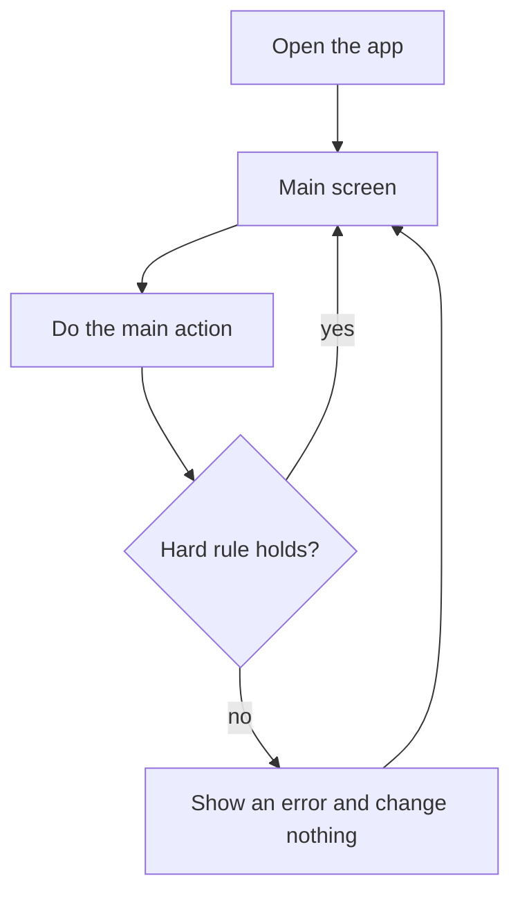

# PLAN: <your app's name>

Copy this file into your task folder as `capstone/PLAN.md`. **Keep every heading** exactly as it is: AxReview finds your answers by them.
Write in plain sentences. Delete the italic hints as you fill each part. Aim for one page per section at most.

## Product

*Name:* <app name>

*Brief:* <StudyTimer | ExpenseSplit | PlantCare | Own pitch>

*The app in two sentences:* <what it does, and for whom>

*Users:* <one or two kinds of user, and what each needs>

Approved by <mentor's name> on <date>

## Hard rule

*The rule, in one sentence:* <what must always be true>

*An example with real values:* <for example "Three friends, 1,000.00 total; balances +666.66, -333.33, -333.33 sum to 0.00">

*Edge cases you will test (at least three):*

1. <for example: the app is closed and reopened>
2. <for example: midnight passes>
3. <for example: an amount that does not divide evenly>

## User stories

*6 to 10 stories, numbered S01 onwards. Each has 2 or 3 acceptance criteria written as Given, When, Then, with real values. Every story has an unhappy path (bad input, no network, nothing saved yet). At least one story tries to break the hard rule.*

### S01: <short title>

As a <user>, I want <what> so that <why>.

- Given <a starting state>, when <an action>, then <a result you can check>.
- Given <...>, when <the unhappy path>, then <what the app shows>.

### S02: <short title>

...

## Must-haves and nice-to-haves

*Must: the stories the app is not worth demoing without, at most the number your task brief gives. Nice: the rest. Then three things the app will not do (for example: iOS, server push, photo uploads).*

| Story | Must or Nice | Why |
|---|---|---|
| S01 | Must | |

*The app will not:*

1.
2.
3.

## Screens and wireframes

*3 to 5 screens. For each: its name (and route), the story IDs it serves, a text wireframe in a code block, and its list of components. Mark the main screen.*

### Screen 1: <name> (main screen)

Stories: S01, S02

```text
+------------------------------+
| <App name>              [+]  |
|------------------------------|
| <row>                        |
| <row>                        |
|                              |
| <empty state text>           |
+------------------------------+
```

Components: <for example `View`, `Text`, `FlatList`, `Pressable`, `TextInput`, a `Stack` or `Tabs` layout from Expo Router>

## Flows

*A Mermaid flowchart of the main flow, from opening the app to the hard-rule action and back. It renders on GitHub.*



## Data and storage

*Where the data lives, and one reason: on the device (AsyncStorage, as in HabitLoop) or Firestore on the free Spark plan (as in ShopList; adds sign-in and security rules). Later, in the build tasks, add your TypeScript types here: each field, its type, and which story needs it.*

*Storage:* <device | Firestore>, because <one reason>

## Build plan

*For each build task, the story IDs it delivers and your estimate in hours. Cut Must stories until the total fits about 11 hours. Say what you will cut first if you run late.*

| Task | Delivers (story IDs) | Hours |
|---|---|---|
| Data model and main screen | | |
| Second screen and navigation | | |
| Save the data and test the hard rule | | |
| Component tests for the main flow | | |
| **Total** | | |

*Cut first if late:* <story ID>
